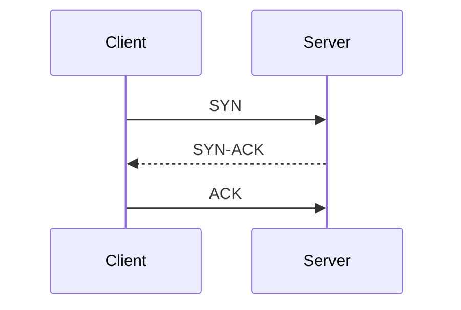

# Nova

**Nova** is a sleek, dark, terminal-inspired minimalist theme for [Hugo](https://gohugo.io/). Designed for software engineers, systems thinkers, and technical writers who appreciate typographic restraint, fast page loads, and disciplined visual hierarchy.

Inspired by observatory telemetry, monospace terminals, and clean editorial reading experiences.

---

## Highlights & Design Philosophy

- **Dark Terminal Aesthetic:** Deep obsidian palette (`#0f0f11`), subtle hairlines, terminal green signal accents (`#26d07c`), astronomy blue links (`#6aa6ff`), and warm rust highlights (`#d45b45`).
- **Signal Progress Bar:** A smooth, glowing top reading progress indicator that appears dynamically as you scroll through long-form articles.
- **Interactive Post Filtering:** Client-side filter panel on the **Signal** (posts) archive with instantaneous tag and year filtering, live counters, and zero page reloads.
- **The Substrate (Notes Stream):** A continuous, unified micro-essay timeline for field notes and quick observations with anchor permalinks.
- **From The Forge (Projects Showcase):** High-density project catalog with direct live site links (`live ↗`), GitHub repository badges (`gh ↗`), and dedicated case study views.
- **The Workbench (Consulting / Advisory):** Purpose-built layout for engineering advisory, capability breakdowns, and engagement offerings.
- **Mermaid Diagram Integration:** Automatic, dark-themed diagram rendering (sequence diagrams, flowcharts, class diagrams) loaded dynamically from ESM CDN only when diagrams exist on the page.
- **Code Block Copy Buttons:** Convenient one-click clipboard copying for code snippets.
- **Zero Heavy Dependencies:** Built with pure CSS custom properties and lightweight vanilla JavaScript. No heavy frontend frameworks or build steps required.

---

## Directory Structure

```text
nova/
├── archetypes/           # Content templates (posts, notes, projects, default)
├── assets/
│   ├── css/
│   │   ├── tokens.css    # Colors, typography scales, spacing tokens
│   │   ├── main.css      # Layout, containers, components, prose
│   │   └── syntax.css    # Dark terminal Chroma syntax highlighting
│   └── js/
│       ├── main.js       # Signal indicator, code copy buttons
│       └── filter.js     # Live year & tag filter panel
├── layouts/
│   ├── _default/         # Base template, single, list, summary
│   ├── partials/         # Head, header, footer, signal bar, mermaid
│   ├── shortcodes/       # Callouts, mermaid, figures
│   ├── posts/            # Filterable list and article single
│   ├── notes/            # Substrate micro-essay stream
│   └── projects/         # Forge catalog and detail views
├── static/
│   └── favicon.svg       # Terminal SVG favicon
├── exampleSite/          # Self-contained demo site
├── theme.toml            # Hugo theme metadata
└── README.md
```

---

## Installation

### Option 1: Git Submodule (Recommended)

From the root of your Hugo project:

```bash
git submodule add https://github.com/tmunongo/nova.git themes/nova
```

In your `hugo.toml` (or `config.toml`):

```toml
theme = "nova"
```

### Option 2: Hugo Modules

If you are using Hugo Modules:

```bash
hugo mod init my-site
hugo mod get github.com/tmunongo/nova
```

In `hugo.toml`:

```toml
[module]
  [[module.imports]]
    path = "github.com/tmunongo/nova"
```

---

## Testing the `exampleSite`

You can test and preview the theme immediately using the included `exampleSite/`:

```bash
cd exampleSite
hugo server --themesDir ../..
```

Open [http://localhost:1313](http://localhost:1313) in your browser.

---

## Configuration (`hugo.toml`)

Here is an example configuration for your site:

```toml
baseURL = "https://yourdomain.com/"
languageCode = "en-us"
title = "Observatory Terminal"
theme = "nova"

[taxonomies]
  tag = "tags"
  series = "series"

[markup]
  [markup.goldmark.renderer]
    unsafe = true # Allows raw HTML in markdown when needed
  [markup.highlight]
    noClasses = false
    guessSyntax = true

[params]
  description = "A workspace for thought, craft, and engineering precision"
  logo_text = "t23o"

  # Unified container width: maintains consistent grid alignment across all pages
  # Recommended values: "860px", "880px", or "900px"
  container_width = "880px"

  [params.author]
    name = "Your Name"
    fediverse = "username@instance.social"

  [params.social]
    github = "yourusername"
    fediverse = "https://instance.social/@yourusername"

  # Home page hero configuration
  [params.hero]
    role = "Full Stack Product Engineer"
    title = ""
    description = "I design and build resilient distributed systems, event pipelines, and developer tooling."

  # Home page call-to-action banner
  [params.cta]
    title = "Need Something Built?"
    text = "Available for select engineering, systems architecture, and advisory contracts."
    button_text = "Visit The Workbench →"
    url = "/consulting/"

# Navigation Menu
[menu]
  [[menu.main]]
    name = "Signal"
    url = "/posts/"
    weight = 10

  [[menu.main]]
    name = "Substrate"
    url = "/notes/"
    weight = 20

  [[menu.main]]
    name = "Observatory"
    url = "/about/"
    weight = 30

  [[menu.main]]
    name = "Forge"
    url = "/projects/"
    weight = 40

  [[menu.main]]
    name = "Library"
    url = "/library/"
    weight = 50

  [[menu.main]]
    name = "Workbench"
    url = "/consulting/"
    weight = 60
    [menu.main.params]
      class = "workbench-cta"
```

---

## Content Archetypes & Frontmatter

### 1. Posts (`content/posts/my-post.md`)

```yaml
---
title: "Designing Resilient Event-Driven Pipelines"
description: "Patterns for building webhook ingestion and background queue processors."
date: 2026-02-15
tags: ["distributed-systems", "architecture", "queues"]
series: ["Systems Engineering"]
draft: false
readTime: true
recommended: true
fediverse: "username@instance.social"
hackernews: "https://news.ycombinator.com/item?id=..."
---
```

### 2. Notes / Micro-essays (`content/notes/field-note.md`)

All notes automatically stream chronologically in the **Substrate** view:

```yaml
---
title: "The Simplicity Tax"
date: 2026-01-10
tags: ["architecture"]
---
A quick thought, observation, or architectural field note.
```

### 3. Projects (`content/projects/my-tool.md`)

Displayed in **The Forge** with optional external links:

```yaml
---
title: "Doorman Engine"
date: 2025-09-12
description: "Self-hostable, low-overhead privacy analytics engine written in Go."
tags: ["go", "sqlite", "analytics"]
featured: true
link: "https://example.com"
github: "https://github.com/example/doorman"
---
```

---

## Mermaid Diagrams

Add diagrams directly inside markdown using the `mermaid` code block or shortcode:

````markdown

````

Diagrams are styled automatically to match Nova's terminal dark aesthetic.

---

## Customizing Layout Width & Styles

If you wish to change the unified width across the site, set `params.container_width` in your `hugo.toml`:

```toml
[params]
  container_width = "920px"
```

To override CSS custom properties, create `assets/css/custom.css` in your project root or override variables in `:root`.

---

## License

Released under the [MIT License](LICENSE).
