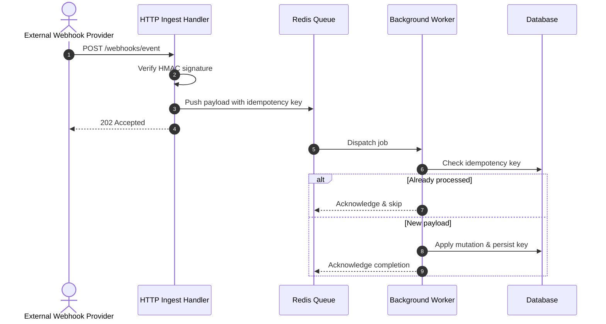

When building webhook ingestion pipelines for high-volume platforms, failure is an inevitability rather than an edge case. Upstream services can retry payloads unexpectedly, network timeouts can partition servers, and concurrent workers can attempt simultaneous mutations against identical database records.

In this article, we examine architectural patterns for decoupling ingestion from processing using deterministic locks and idempotency keys.

## The Ingestion Architecture

A resilient pipeline isolates the HTTP reception layer from the state mutation layer:



## Idempotency and Deduplication in Go

To prevent duplicate execution, each incoming payload must compute a deterministic hash across the event identifier and timestamp.

```go
package pipeline

import (
	"crypto/sha256"
	"encoding/hex"
	"fmt"
)

// ComputeKey generates a unique idempotency token for an event
func ComputeKey(provider string, eventID string, payload []byte) string {
	hasher := sha256.New()
	hasher.Write([]byte(fmt.Sprintf("%s:%s:", provider, eventID)))
	hasher.Write(payload)
	return hex.EncodeToString(hasher.Sum(nil))
}
```

## Failure Modes and Retries

When background queue workers fail, backoff schedules must prevent thundering herds against dependent databases:

| Phase | Strategy | Typical Timeout |
| :--- | :--- | :--- |
| Ingestion | Fast HMAC verification & queue push | < 50ms |
| Queue Dispatch | At-least-once delivery | Immediate |
| Worker Retry | Exponential backoff with jitter | 2s, 8s, 32s |
| Dead Letter Queue | Manual replay & alert | 7 days retention |

By separating ingress validation from execution, your system remains responsive even during downstream degradation.

